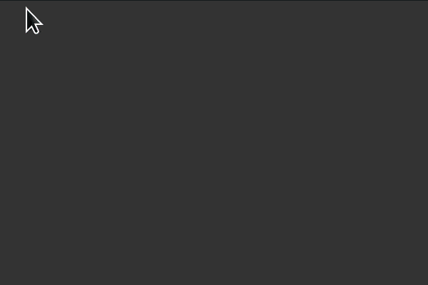
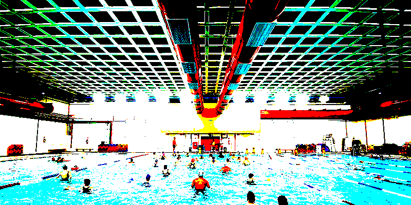
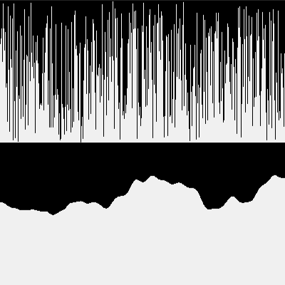
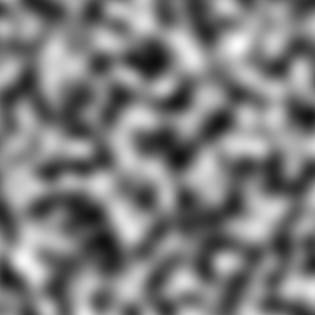
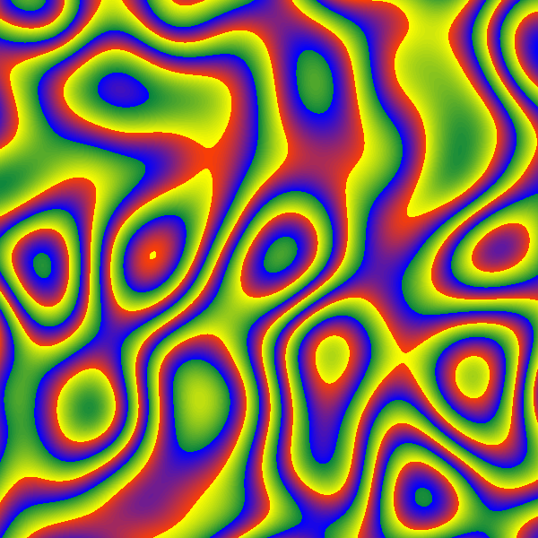

## Agenda

- **Quem somos?** <br>*Who are we?*
- **Programação Criativa?** <br>*Creative Coding?*
- **Conceitos básicos de NumPy** <br> *Basic concepts of the NumPy library*
- **NumPy & Pixels**
- **NumPy & Operações Vetorizadas** <br> *Numpy & Vectorized Operations*
- **NumPy & Simulações** <br> *NumPy & Simulations*
- **Encerramento e Perguntas** <br> *Wrap-up and Questions*

::: notes
Speaker Notes
:::

# Quem somos? <br>*Who are we?*


- Jim

- Alexandre


# O contexto da programação criativa & py5 <br>*the context of creative coding & py5*

## Essas práticas artísticas tem muitos nomes!

*These artistic practices have many names!*

{width="1200"}


## Por que um artista deveria programar?

*Why should an artist program?*

{width="800"}

::: {.credit}
John Simon, Jr. *Authorship, Creativity, and Code*
:::

::: notes
Creative Coding is the practice of writing software as a form of creative expression. The "Creative Coding" world includes people outside of professional software developers. It includes beginner coders, hobbyists, designers, educators, artists, and more.
:::

## O que é py5? *What is py5?*

py5 é uma biblioteca, ou um *framework*, para programação criativa.<br>
*py5 is a Creative Coding libray/framework.*

:::: {.columns}
::: {.column width="35%"}



:::
::: {.column width="65%"}

```{python}
#| eval: false

```
:::
::::

::: notes
In this presentation we will use the Python library py5. 
This library is used extensively in educational settings and also to create art.
:::

## O que é py5? *What is py5?*

Na sala de aula podemos usar o **modo importado**<br>
*In a classroom setting we can use <b>imported mode</b>*

:::: {.columns}
::: {.column width="35%"}


:::
::: {.column width="65%"}

```{python}
#| eval: false

```
:::
::::


::: notes
Very quickly mentioning imported mode
:::


# Alguns trabalhos feitos com py5, pra valer...<br>*Some work done with py5, for real...*


## {.credit-slide background-image="images/times-square-river-is-a-circle.png" background-size="cover"}

::: {.credit-bar}
The River is a Circle (Times Square Edition) by Marina Zurkow & James Schmitz

(photo courtesy of Times Square Alliance)
:::

::: notes
The River is a Circle (Times Square Edition) by Marina Zurkow & James Schmitz.
(photo courtesy of Times Square Alliance)
:::


## {.credit-slide background-image="images/4-covers.png" background-size="contain"}

::: {.credit-bar}
Capas da coleção "Pensando Amanhãs" do Museu do Amanhã

design de Alexandre Villares e Elaine Ramos
:::


## {.credit-slide background-image="images/many-covers.gif" background-size="cover"}

{.nostretch}

# Conceitos básicos de Numpy *Basic concepts of the NumPy library*

## Operações vetorizadas e *broadcast*

*Vectorized / Broadcast Operations*

```{python}
#| output-location: fragment
nums = [1, 2, 3, 4, 5]  # a Python list
nums * 2
```

```{python}
#| error: true
#| output-location: fragment
nums / 2
```

```{python}
#| output-location: fragment
import numpy as np

a = np.array([1, 2, 3, 4, 5])
a * 2
```

```{python}
#| output-location: fragment
a / 2
```


## Expressões complexas mais legíveis

*Complex expressions become easier to read*

```{python}
#| output-location: fragment
a ** 2 + 3 * a - 4
```

```{python}
#| output-location: fragment
np.sin(a)
```

::: notes
NOTE: in this slide the code block outputs will appear one at a time after hitting the space bar.
:::

## Máscaras e indexação com arrays

*Masking & Array Indexing*

```{python}
#| output-location: fragment
import numpy as np

b = np.array([0, 10, 20, 30, 40])
idxs = np.array([1, 2, 4])
b[idxs]
```

```{python}
#| output-location: fragment
mask = [True, False, True, True, False]
b[mask]
```

```{python}
#| output-location: fragment
b > 20
```

```{python}
#| output-location: fragment
b[b > 20]
```

::: notes
NOTE: in this slide the code block outputs will appear one at a time after hitting the space bar.
:::

# Como NumPy é usado para representar pixels de uma imagem <br>*How NumPy is used to represent image pixels*


## Vejamos uma imagem comum feita de pixels{background-image="images/original-swimming-pool.png" background-size="cover"}

*Let's have a look at a common raster image*


## Carregando pixels como um array NumPy

*Loading the pixels as a NumPy array*

:::: {.columns}
::: {.column width="40%"}


:::
::: {.column width="60%"}

```{python}
#| eval: false
#| code-line-numbers: "|5-6|7-8|9-10"

import py5

def setup():
    py5.size(800, 400)
    img_path = 'piscina.png'
    img = py5.load_image(img_path)
    img.load_np_pixels()
    pixels_array = img.np_pixels  
    print(pixels_array.shape) # (400, 800, 4)
    print(pixels_array) 

py5.run_sketch()
```
:::
::::

. . . 

```python
(400, 800, 4)

[[[255  96 119 105]
  [255  37  61  49]
  [255   2  30  20]
  ...
  [255  15  43  34]
  [255  16  42  33]
  [255  16  42  31]]

 [[255 124 146 130]
  [255 105 132 115]
  [255  63  89  75]
  ...
  [255  19  42  34]
  [255  20  43  34]
  [255  20  43  32]]

 [[255 110 132 116]
  [255 111 133 117]
  [255 118 141 125]
  ...
  [255  20  43  34]
  [255  19  44  32]
  [255  21  42  33]]

 ...

 [[255  92 157 170]
  [255  78 148 162]
  [255 100 159 172]
  ...
  [255 112 168 178]
  [255 119 171 181]
  [255 118 170 181]]

 [[255 129 181 194]
  [255 114 171 183]
  [255  98 157 170]
  ...
  [255  92 162 177]
  [255 100 165 178]
  [255 105 165 177]]

 [[255 130 175 186]
  [255  95 153 166]
  [255  75 142 157]
  ...
  [255  75 153 170]
  [255  82 157 173]
  [255  84 157 172]]]

```


## Manipulando fatias do array!
*Manipulating array slices!*


:::: {.columns}
::: {.column width="40%"}


:::
::: {.column width="60%"}

```{python}
#| eval: false
#| code-line-numbers: "|0-3|4-11|5|6|7-8|10"

```

:::
::::

## {.credit-slide background-image="images/red-blue-swimming-pool.png" background-size="cover"}

## Um filtro de saturação na unha!
*A saturation filter from scratch*


:::: {.columns}
::: {.column width="40%"}



:::
::: {.column width="60%"}

```{python}
#| eval: false

```

:::
::::

## {.credit-slide background-image="images/saturated-swimming-pool.png" background-size="cover"}


## Uma imagem direto de um array Numpy!
*An image straight from a NumPy array!*

:::: {.columns}
::: {.column width="40%"}


:::
::: {.column width="60%"}

```{python}
#| eval: false
#| code-line-numbers: "|7-8|10-12|14"

```

:::
::::

::: notes

The code-line-numbers bit can highlight specific lines that we can step through
in the presentation. 
:::

## E é assim que outras bibliotecas do ecossistema Python fazem também!

*And this is how other libraies in the Python ecossystem do it too!*

Pillow, Raster.io, OpenCV...

```{python}
#| eval: false
#| code-line-numbers: "|13-16|18-27|29-33|35-45|48"

```

# Usando "ruído" em operações vetoriazadas <br>*Using "noise" in vectorized operations*

## Qual a diferença entre "ruído" e "random"?

*First, what is the difference between "noise" and "random"?*

:::: {.columns}
::: {.column width="40%"}



:::
::: {.column width="60%"}

```{python}
#| eval: false

```

:::
::::


## Noise em 2D / 3D

Exemplo do Tom Larrow

:::: {.columns}
::: {.column width="40%"}



:::
::: {.column width="60%"}

```{python}
#| eval: false

```

:::
::::


## Agora um exemplo avaçado 

Uma grade 2D de posições e mapeia os valores em uma paleta que é um array de cores...


:::: {.columns}
::: {.column width="40%"}



:::
::: {.column width="60%"}

```{python}
#| eval: false

```

:::
::::


# NumPy in Simulations

## Partículas! *Particles!*


:::: {.columns}
::: {.column width="40%"}


:::
::: {.column width="60%"}

```{python}
#| eval: false

```

:::
::::


## *Flocking*: Cardumes e revoadas


## E tantas outras coisas! *And so much more!*

# Encerramento <br>*Wrap-up*

Esperamos que depois disso você nos acredite que, mesmo sem grandes conhecimentos de computação científica ou ciência de dados, todo mundo pode usar bibliotecas Python avançadas para criar uma grande variedade de coisas!

*We hope that after this you believe us that even without deep knowledge of scientific computing or data science, we can all use advanced Python libraries to create a wide variety of things!*

# Obrigado! *Thank you!*
## Para mais sobre nós & py5... <br>*For more about us & py5...*

- Main: [**py5coding.org**](https://py5coding.org/)
- Forum: [**github.com/py5coding/py5generator/discussions**](https://github.com/py5coding/py5generator/discussions/)
- Mastodon: [**fosstodon.org/@py5coding**](https://fosstodon.org/@py5coding)

. . .

<h2>FAÇAM PERGUNTAS! <i>ASK QUESTIONS!</i><h2>
