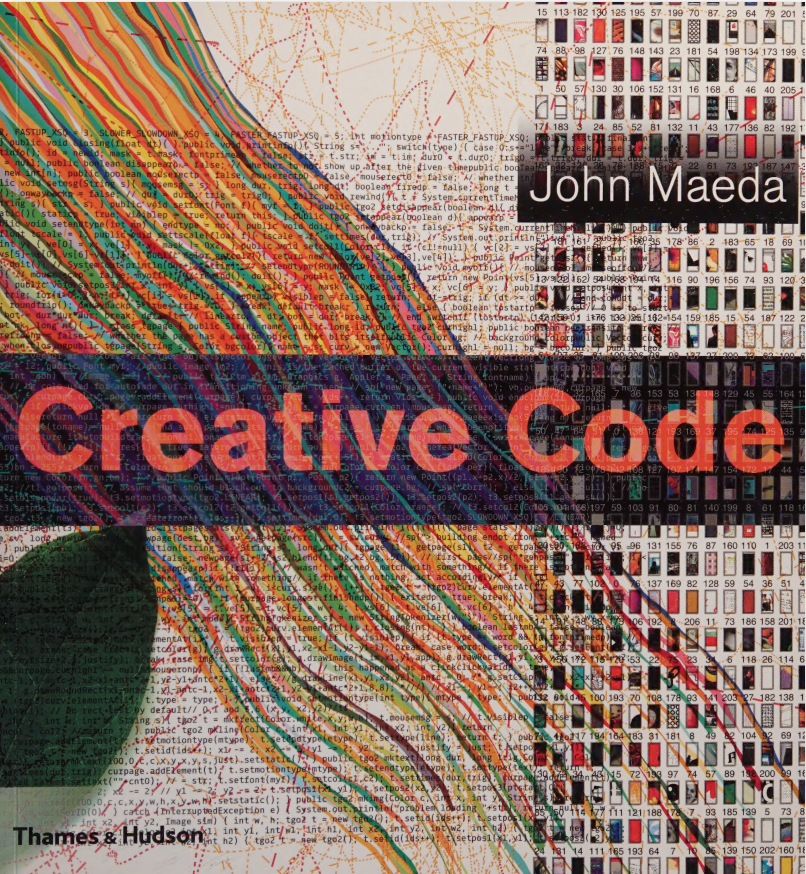
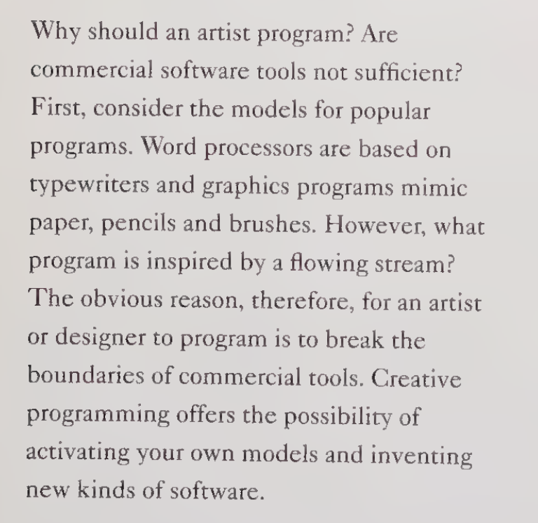
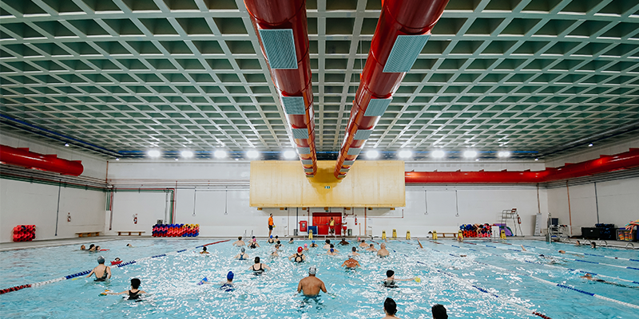
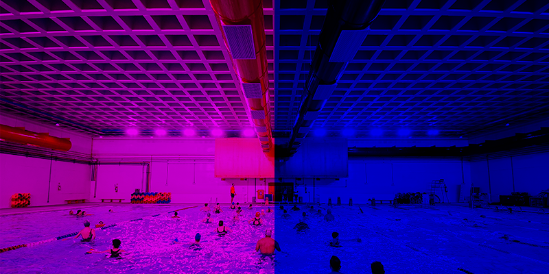

## Agenda

- **Quem somos?** <br>*Who are we?*
- **Programação Criativa?** <br>*Creative Coding?*
- **Conceitos básicos de NumPy** <br> *Basic concepts of the NumPy library*
- **NumPy & Pixels**
- **NumPy & Operações Vetorizadas** <br> *Numpy & Vectorized Operations*
- **NumPy & Simulações** <br> *NumPy & Simulations*
- **Encerramento e Perguntas** <br> *Wrap-up and Questions*

::: notes
Speaker Notes
:::

# Quem somos? <br>*Who are we?*


- Jim

- Alexandre


# O contexto da programação criativa & py5 <br>*the context of creative coding & py5*

## Essas práticas artísticas tem muitos nomes!

*These artistic practices have many names!*

{width="1200"}


## Por qual motivo um artista deveria programar?

*Why should an artist program?*

{width="800"}

::: {.credit}
John Simon, Jr. *Authorship, Creativity, and Code*
:::

::: notes
Creative Coding is the practice of writing software as a form of creative expression. The "Creative Coding" world includes people outside of professional software developers. It includes beginner coders, hobbyists, designers, educators, artists, and more.
:::

## O que é py5? *What is py5?*

Um *framework* para programaçaõ criativa.
*A Creative Coding framework*

::: notes
TODO: add simple example here

In this presentation we will use the Python library py5. This library is used extensively in educational settings and also to create art.
:::

## {.credit-slide background-image="images/times-square-river-is-a-circle.png" background-size="cover"}

::: {.credit-bar}
The River is a Circle (Times Square Edition) by Marina Zurkow & James Schmitz

(photo courtesy of Times Square Alliance)
:::

::: notes
The River is a Circle (Times Square Edition) by Marina Zurkow & James Schmitz.
(photo courtesy of Times Square Alliance)
:::


## {.credit-slide background-image="images/4-covers.png" background-size="contain"}

::: {.credit-bar}
Capas da coleção "Pensando Amanhãs" do Museu do Amanhã

design de Alexandre Villares e Elaine Ramos
:::


## {.credit-slide background-image="images/many-covers.gif" background-size="cover"}

{.nostretch}

# Conceitos básicos de Numpy *Basic concepts of the NumPy library*

## Operações vetorizadas e *broadcast*

*Vectorized / Broadcast Operations*

```{python}
#| output-location: fragment
nums = [1, 2, 3, 4, 5]  # a Python list
nums * 2
```

```{python}
#| error: true
#| output-location: fragment
nums / 2
```

```{python}
#| output-location: fragment
import numpy as np

a = np.array([1, 2, 3, 4, 5])
a * 2
```

```{python}
#| output-location: fragment
a / 2
```


## Expressões complexas mais legíveis

*Complex expressions become easier to read*

```{python}
#| output-location: fragment
a ** 2 + 3 * a - 4
```

```{python}
#| output-location: fragment
np.sin(a)
```

::: notes
NOTE: in this slide the code block outputs will appear one at a time after hitting the space bar.
:::

## Máscaras e indexação com arrays

*Masking & Array Indexing*

```{python}
#| output-location: fragment
import numpy as np

b = np.array([0, 10, 20, 30, 40])
idxs = np.array([1, 2, 4])
b[idxs]
```

```{python}
#| output-location: fragment
mask = [True, False, True, True, False]
b[mask]
```

```{python}
#| output-location: fragment
b > 20
```

```{python}
#| output-location: fragment
b[b > 20]
```

::: notes
NOTE: in this slide the code block outputs will appear one at a time after hitting the space bar.
:::

# Como NumPy é usado para representar pixels de uma imagem <br>*How NumPy is used to represent image pixels*


## Vejamos uma imagem comum feita de pixels

*Let's have a look at a common raster image*


{width="1200"}

. . .


```{python}
#| eval: false
import numpy as np
import py5

def setup():
    py5.size(800, 400)
    py5.background(0)
    img_path = 'piscina.png'
    img = py5.load_image(img_path)
    img.load_np_pixels()
    print(img.np_pixels.shape) # (400, 800, 4)

py5.run_sketch()
```

---

Manipulando fatias do array!
*Manipulating array slices!*

{width="1200"}

```{python}
#| eval: false
import numpy as np
import py5

def setup():
    py5.size(800, 400)
    py5.background(0)
    img_path = 'swimming-pool.png'
    img = py5.load_image(img_path)
    img.load_np_pixels()
    print(img.np_pixels.shape) # shape is (400, 800, 4)
    pa = img.np_pixels
    pa[:, 400:, 1] = 0
    pa[:, :, 2] = 0
    img.update_np_pixels()
    py5.image(img, 0, 0)

    py5.save_frame('red-blue-swimming-pool.png')

py5.run_sketch()
```

---

Uma imagem direto de um array Numpy!
*An image straight from a NumPy array!*


{width="1000"}

. . .


```{python}
#| eval: false
#| code-line-numbers: "|7-8|10-12|14"

import py5
import numpy as np

def setup():
    py5.size(900, 600)
    w, h = py5.width, py5.height
    R = np.linspace(0, 255, w).reshape(1, -1)
    G = np.linspace(0, 255, h).reshape(-1, 1)
    B = np.random.uniform(128, 255, (h, w))
    A = np.array([[128 + py5.dist(w /2, h / 2, x, y) % 128
                   for x in range(w)]
                   for y in range(h)])
    rgba = np.dstack(np.broadcast_arrays(R, G, B, A))
    img = py5.create_image_from_numpy(rgba, 'RGBA')
    py5.image(img, 0, 0)

py5.run_sketch()
```

::: notes

The code-line-numbers bit can highlight specific lines that we can step through
in the presentation. 
:::

## E é assim que outras bibliotecas do ecossistema Python fazem também!

*And this is how other libraies in the Python ecossystem do it too!*

Pillow, Raster.io, OpenCV...

[Running the OpenCV example]


# Usando "ruído" em operações vetoriazadas <br>*Using "noise" in vectorized operations*

## Primeiro, qual a diferença entre "ruído" e "aleatório"?

*First, what is the difference between "noise" and "random"?

```{python}
#| eval: false
#| code-line-numbers: "|13-16|18-27|29-33|35-45|48"

```

::: notes
NOTE: in this slide the code block will not execute. We will need to switch to
a terminal and run a command. Using an include statement is useful and keeps
everything in sync.

The code-line-numbers will scroll for us because the code is too big for the slide.
:::

# NumPy in Simulations

## Partículas! *Particles!*


## *Flocking*: Cardumes e revoadas


## E tantas outras coisas! *And so much more!*

# Encerramento <br>*Wrap-up*

Esperamos que depois disso você nos acredite que, mesmo sem grandes conhecimentos de computação científica ou ciência de dados, todo mundo pode usar bibliotecas Python avançadas para criar uma grande variedade de coisas!

*We hope that after this you belive us that even without deep knowledge of scientific computing or data science, we can all use advanced Python libraries to create a wide variety of things!*

# Obrigado! *Thank you!*
## Para mais sobre nós & py5... <br>*For more about us & py5...*

- Main: [**py5coding.org**](https://py5coding.org/)
- Forum: [**github.com/py5coding/py5generator/discussions**](https://github.com/py5coding/py5generator/discussions/)
- Mastodon: [**fosstodon.org/@py5coding**](https://fosstodon.org/@py5coding)

. . .

<h2>FAÇAM PERGUNTAS! <i>ASK QUESTIONS!</i><h2>


------------------------------------------------------------------------

New Slide with code and no header

```{python}
import numpy as np

np.random.rand(10)
```
